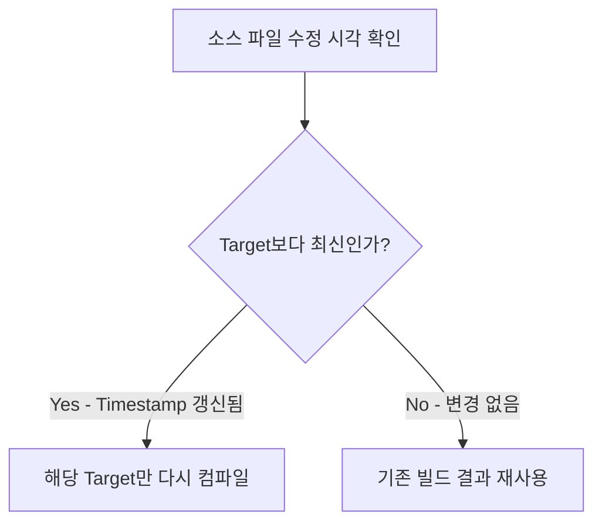
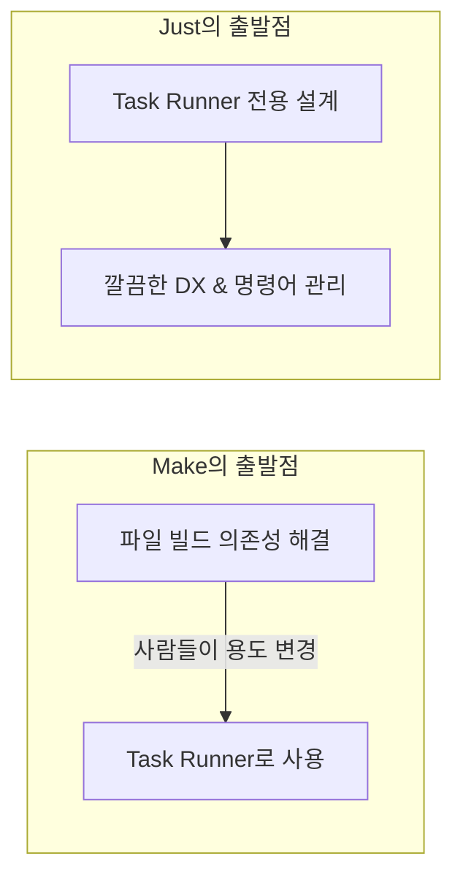

Go 프로젝트를 진행하면서 자연스럽게 `Makefile`을 사용하게 되었습니다.

처음에는 단순히 `build`, `test`, `lint` 같은 긴 명령어를 짧게 실행하기 위한 용도로 사용했습니다.

```bash
make test
make dev
make deploy
```

팀원들도 같은 명령어를 쓰고, 긴 옵션을 매번 기억하지 않아도 돼서 편했습니다. 저는 Makefile을 프로젝트 명령어 모음으로 쓰고 있었습니다.

Temporal Python SDK 코드를 살펴보다가 `just`라는 명령어를 발견했습니다. 제 프로젝트에도 써보니 `.PHONY`나 탭 들여쓰기 없이 같은 명령어를 정리할 수 있었습니다. 옮기는 과정에서 Make가 원래 어떤 문제를 해결하는 도구인지도 다시 찾아봤습니다.

---

## Make는 파일 의존성을 보고 빌드한다

제가 쓰던 Makefile에는 파일 의존성이 거의 없었습니다. `make test`를 실행하면 `go test`를 호출하는 정도였습니다. Make의 원래 용도를 살펴보니 이 부분이 달랐습니다.

Make는 1976년 Bell Labs의 **Stuart Feldman**이 만들었습니다.


C 프로젝트에서 소스 파일 하나를 고칠 때마다 전체를 다시 컴파일하면 시간이 많이 듭니다. Make는 파일 사이의 의존성과 수정 시각을 보고, 다시 빌드해야 할 타깃을 골라 실행합니다. 이를 증분 빌드(Incremental Build)라고 합니다.



Make는 타깃 파일(Target)과 소스 파일의 **수정 시각(Timestamp)**을 비교해, 소스가 더 최신일 때만 해당 타깃을 다시 컴파일합니다.

```text
main.c  (10:00 수정)
main.o  (09:00 빌드됨)
→ main.c가 더 최신이므로 main.o만 다시 빌드
```

Makefile의 타깃에는 생성할 파일과 그 파일이 의존하는 입력을 적습니다. 제가 쓰던 명령어 모음에는 이 의존성 관리 기능이 필요하지 않았습니다.

---

## Go 프로젝트에서 Makefile을 쓴 이유

`go build`와 `go test`는 패키지 의존성과 빌드 캐시를 관리합니다. 제 Go 프로젝트에서 Makefile이 맡았던 일은 빌드 의존성 계산보다 명령어를 짧게 묶는 것이었습니다.

프로젝트에서 자주 실행하는 명령어에는 이런 것들이 있었습니다.

```bash
go test -v -race ./...
golangci-lint run --timeout=5m
docker compose -f docker-compose.dev.yml up -d
buf generate
```

이걸 팀원마다 다르게 입력하지 않도록, `make test`, `make dev`라는 표준 진입점으로 감싸둔 것입니다.

```make
.PHONY: test lint dev

test:
	go test -v -race ./...

lint:
	golangci-lint run

dev:
	docker compose -f docker-compose.dev.yml up -d
```

이렇게 쓰면 팀원은 세부 옵션을 몰라도 `make test`로 테스트를 실행할 수 있습니다. 이 용도만 놓고 보면 빌드 도구의 기능보다는 공통 진입점이 필요했던 셈입니다.

---

## 명령어만 관리할 때 불편했던 점

Make에 익숙해서 처음에는 불편함을 크게 느끼지 않았습니다. 다만 명령어가 늘면서 탭 들여쓰기, 셸 변수 이스케이프, `.PHONY` 선언을 계속 신경 써야 했습니다.

### 1) 들여쓰기 TAB 제약
Makefile에서는 레시피 앞을 **반드시 `TAB`**으로 들여써야 합니다. 스페이스 4칸을 넣으면 즉시 에러(`missing separator`)가 납니다. 익숙해지면 조심하지만, 단순히 커맨드를 정리하려는 용도에서 이런 제약까지 신경 써야 한다는 점은 조금 어색했습니다.

### 2) Shell script와의 어색한 결합
명령어가 조금만 길어지거나 순차 실행이 필요하면 라인 끝마다 `\`와 `&&`를 이어붙여야 하고, 변수를 참조할 때도 `$$VAR`처럼 이스케이프해야 합니다. 점점 읽기 어려운 쉘 스크립트 덩어리가 되기 십상입니다.

### 3) `.PHONY` 남발
Make는 기본적으로 타깃을 '생성될 파일명'으로 인식합니다. 폴더에 우연히 `test`라는 폴더나 파일이 있으면 `make test`는 "이미 최신 상태"라며 실행되지 않습니다. 이를 막기 위해 매번 `.PHONY: test lint dev`를 선언해줘야 했습니다.

---

## Just로 같은 명령어를 정리하기

Just는 프로젝트별 명령어를 저장하고 실행하는 도구입니다.

Casey Rodarmor가 Rust로 만들었고, 개발 동기는 아래 글에 나와 있습니다.


> "나는 Makefile 문법은 싫지만, make의 편리함은 좋아한다."

공식 문서에서도 용도를 이렇게 설명합니다.

> **"A handy way to save and run project-specific commands"**
> (프로젝트 전용 명령어를 저장하고 실행하는 가장 편리한 방법)

Just에서는 레시피를 실행할 명령어로 다룹니다. 생성될 파일의 수정 시각을 비교하지 않으므로 `test`나 `build`에 `.PHONY`를 붙일 필요가 없습니다.



---

## 옮기면서 편해진 부분

`justfile`로 전환하면서 가장 마음에 들었던 점들을 정리해보았습니다.

### 1) TAB 제약이 없는 직관적인 문법
스페이스든 탭이든 자유롭게 들여쓰기를 사용할 수 있습니다.

```just
test:
    go test -v -race ./...

lint:
    golangci-lint run
```

### 2) 파라미터(인자) 전달과 기본값 지원
Makefile에서 인자를 받으려면 환경변수 트릭(`make deploy ENV=prod`)을 쓰거나 복잡한 가드를 짜야 했습니다. Just는 함수 시그니처처럼 인자와 기본값을 바로 선언할 수 있습니다.

```just
# 기본값 dev, 필요시 인자로 덮어쓰기
deploy env="dev":
    @echo "Deploying to {{env}}..."
    kubectl apply -f infra/k8s/{{env}}/
```

```bash
just deploy       # dev 환경 배포
just deploy prod  # prod 환경 배포
```

필수 인자를 빠뜨리면 필요한 인자와 사용법을 출력합니다.

### 3) 사전 도구 및 환경변수 검증 (Fail Fast)
태스크가 한참 돌다가 마지막 단계에서 도구가 없어 실패하면 난감합니다. Just에서는 백틱(`` ` ``)을 이용해 필수 도구가 있는지 사전에 검증할 수 있습니다.

```just
# 필수 도구 사전 검증 (없으면 즉시 중단)
golangci := `which golangci-lint`

# .env 자동 로드
set dotenv-load
```

> **`uv`로 Just 실행하기**
> 
> Justfile 맨 위에 `#!/usr/bin/env -S uvx --from=rust-just just --justfile` 셰뱅을 넣고 실행 권한(`chmod +x justfile`)을 주면, 시스템에 `just`가 설치되어 있지 않아도 Python의 `uv`를 통해 `./justfile test`로 즉시 실행할 수 있습니다.

---

## Taskfile도 살펴봤다

명령어 실행 외에 파일 변경에 따른 실행 생략도 필요하다면 [Taskfile (go-task)](https://taskfile.dev)을 살펴볼 수 있습니다.

```yaml
# Taskfile.yml 예시
version: '3'

tasks:
  build:
    desc: "서버 바이너리 빌드"
    sources:
      - '**/*.go'
    generates:
      - bin/server
    cmds:
      - go build -o bin/server main.go

  test:
    desc: "단위 테스트 실행"
    cmds:
      - go test -v ./...
```

Taskfile은 YAML로 명령어를 정의합니다. `sources`와 `generates`를 지정하면 파일 변경 여부에 따라 실행을 생략할 수 있습니다.

* **크로스 플랫폼 내장 쉘 ([mvdan/sh](https://github.com/mvdan/sh))**: 여러 OS에서 셸 문법을 일관되게 쓸 수 있습니다. 호출하는 외부 명령어의 설치 여부와 동작 차이는 별도로 확인해야 합니다.
* **파일 해시 기반 스마트 캐싱 (`sources` / `generates`)**: 소스 코드가 변경되지 않았다면 태스크 실행을 자동으로 스킵합니다.
* **병렬 실행 (`--parallel`) & 모듈화 (`includes`)**: 여러 태스크를 동시에 돌리거나 하위 Taskfile을 임포트하기 편리합니다.

---

## 세 도구 비교

세 도구를 비교하면 다음과 같이 정리할 수 있습니다.

| 비교 항목 | Makefile (Make) | Justfile (Just) | Taskfile (Task) |
| :--- | :--- | :--- | :--- |
| **태생 & 언어** | 1976년 (C) | 2016년 (Rust) | 2017년 (Go) |
| **설정 포맷** | 고유 문법 (TAB 필수) | Make와 유사한 간결한 DSL | `Taskfile.yml` (YAML) |
| **주 목적** | 컴파일 의존성 해결 (DAG) | 커맨드 러너 (CLI 경험 중심) | 커맨드 러너 + 빌드 파이프라인 |
| **캐싱 지원** | 파일 timestamp 기반 | 미지원 (단순 실행) | 파일 해시 기반 (`sources`) |
| **윈도우 호환성** | 번거로움 (WSL 등 필요) | 기본 지원 | 내장 쉘 제공, 외부 명령어는 확인 필요 |
| **핵심 장점** | 기존 빌드 환경에서 널리 사용 | 레시피 인자와 간결한 명령어 관리 | 파일 변경 감지, 병렬 실행, 모듈화 |
| **아쉬운 점** | 낡은 문법, `.PHONY` 필요 | 컴파일 캐싱 없음 | YAML 특유의 인덴트 문법 |

---

## 지금은 Just를 쓰고 있다

제 Go 프로젝트에는 `go build`와 `go test`를 묶어 실행할 도구가 필요했습니다. Just로 옮긴 뒤에는 `.PHONY`를 선언하지 않아도 되고, 레시피에 인자와 기본값을 적을 수 있어 편했습니다.

파일 의존성을 관리하는 기존 Makefile이라면 옮기는 비용까지 따져봐야 합니다. 파일 변경 감지나 여러 태스크의 병렬 실행이 필요하면 Taskfile도 후보가 됩니다. 저는 우선 자주 쓰는 명령어를 정리하는 데 Just를 쓰고 있습니다.
